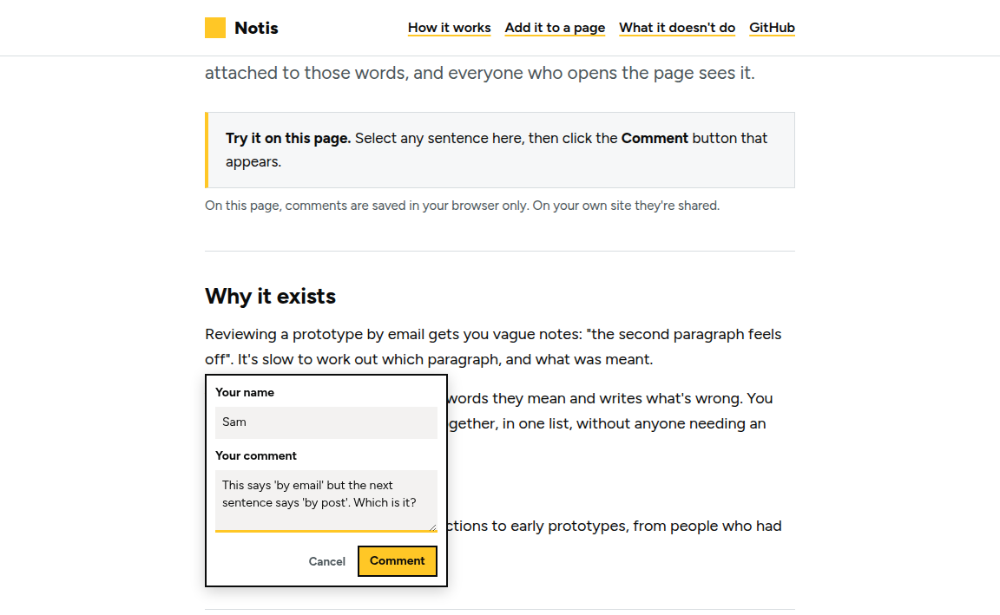
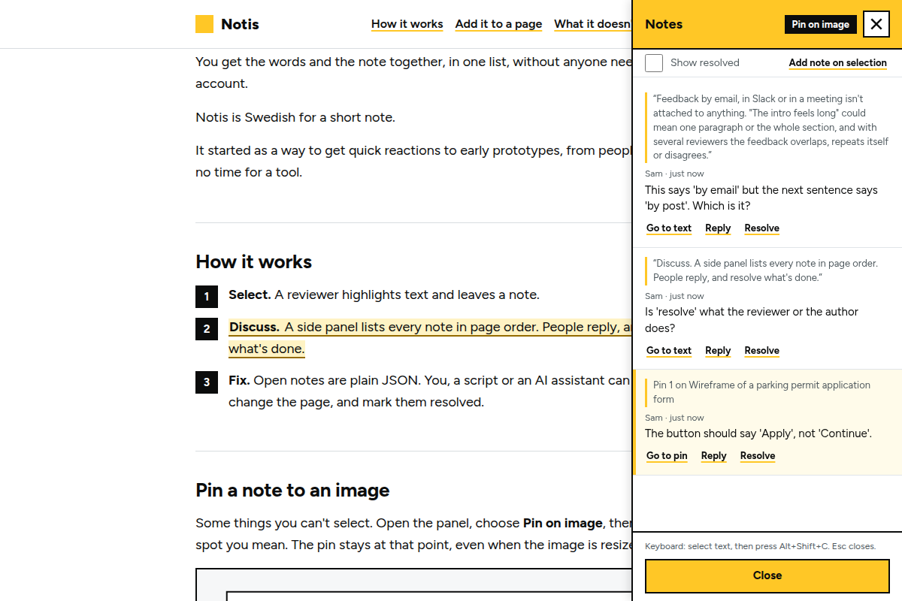
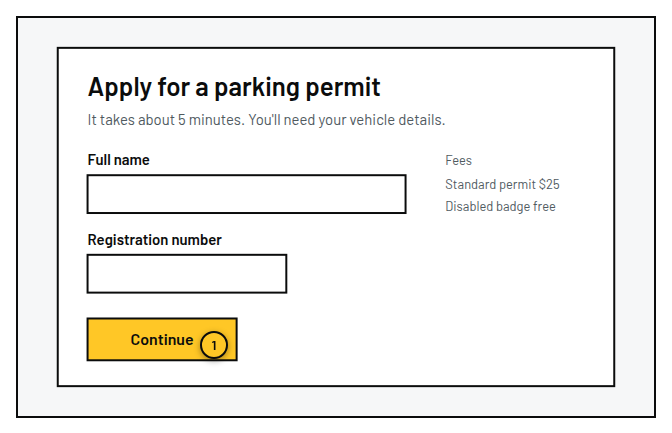

# Notis

[](https://github.com/gavinwye/notis.gavinwye.com/actions/workflows/ci.yml)

Think comments in Google Docs, for any web page. Notis (say it *noh-tis*) is Swedish for a short note: select text on a page and leave a note on it. A side panel lists every note, with replies and resolve, and everyone who opens the page sees the same list.

It's one script on the page and one small serverless function behind it. No accounts, no database to set up, no build step.

**Site:** https://notis.gavinwye.com

## Why it exists

Reviewing a prototype by email means vague notes: "the second paragraph feels off". Here the reviewer selects the words they mean and says what's wrong with them. The note stays attached to those words, and you can see all of them in one place.

It was built to get fast reactions to early prototypes.

## What you get

- **Notes on the exact words.** Select text, leave a note. The highlight stays on that text if the page changes slightly.
- **General page notes.** Leave feedback about the whole page without selecting text or pinning an image.
- **Pins on images.** Choose Pin on image in the panel and click the spot you mean. The pin stays at that point when the image is resized.
- **Threads.** Replies, resolve and reopen, and a toggle to show resolved ones.
- **Shared.** Everyone who opens the page sees the same notes.
- **Updates while you review.** Notis checks for new notes every 25 seconds while the page is visible and again when you return to it. It pauses while a draft is being written.
- **A JSON API.** A script (or an AI assistant) can read the open notes and work through them. See [Closing the loop](#closing-the-loop).
- **Portable feedback.** Copy the page's notes as Markdown or download them as JSON from the panel.
- **One file in, one file out.** `comments.js` has no dependencies and injects its own styles.

## What it looks like



The note box asks for a name once, then the note.



Every note is in one list, in the order it appears on the page.



A pin marks a point on an image. It stays there when the image is resized.

## Try it

```bash
git clone https://github.com/gavinwye/notis.gavinwye.com
cd notis.gavinwye.com
npm install
npx netlify dev        # http://localhost:8888
```

Open the page, select some text, and leave a note. You need the [Netlify CLI](https://docs.netlify.com/cli/get-started/) and `netlify login`.

## Ask an agent to add it

Paste this into a coding agent (Claude Code, Codex, Cursor) working in your site's folder:

```
Add Notis to this site. Follow the instructions at https://notis.gavinwye.com/install.md
```

[`site/install.md`](site/install.md) is written for the agent. It asks where Notis should run, copies the script, adds one line to your layout, sets up storage if you want it shared, and checks it works. It asks before it adds a function or touches production. There's also an [`llms.txt`](https://notis.gavinwye.com/llms.txt).

## Add it to a page

Copy the widget into your own site, then add one line before `</body>`:

```html
<script src="/comments.js" defer></script>
```

The file runs from your own server: visitors never contact notis.gavinwye.com, and it only changes when you change it. Out of the box it keeps one thread list per URL path and stores them through `/api/comments`.

### Get the file

`https://notis.gavinwye.com/version.json` lists the current version, its address, its checksum and the server files. Download the versioned file into your site's static folder and check it:

```bash
curl -fsSL https://notis.gavinwye.com/v0.3.1/comments.js -o public/comments.js
curl -fsSL https://notis.gavinwye.com/v0.3.1/comments.js.sri       # "sha384-" followed by the same text as:
openssl dgst -sha384 -binary public/comments.js | openssl base64 -A
```

Everything under `/v<version>/` is immutable: the same address always returns the same bytes, so a copy that matches the checksum is exactly what was released. (Use the version `version.json` shows; `v0.3.1` here is the latest at the time of writing.)

**Just trying it?** You can load it straight from this site instead. This is not recommended for production, because every visitor's browser then fetches the file from notis.gavinwye.com, so your page depends on it being up and the Notis site sees each visit. Use the versioned address with its integrity hash, so the browser refuses a file that doesn't match:

```html
<script src="https://notis.gavinwye.com/v0.3.1/comments.js"
        integrity="sha384-O1JkOvtU6pF5DrL2wz0QKOsFJ2PznDX1e9ltLKMkvpAU6K23JvK/OtFatbqlw7DA"
        crossorigin="anonymous" defer></script>
```

The ready-made tag for the current version is at `https://notis.gavinwye.com/v<version>/snippet.html`.

It's also prepared for npm as `@gavinwye/notis`: the widget is `@gavinwye/notis/comments.js`, and the servers are under `@gavinwye/notis/server/…`. It's not published yet, so for now use the copy above.

### Options

Set them with a global before the script, or with `data-*` attributes on the tag.

```html
<script>window.COMMENTS_CONFIG = { pageId: "homepage", root: "main", dock: true };</script>
<script src="/comments.js" defer></script>

<!-- or -->
<script src="/comments.js" data-page-id="homepage" data-root="main" data-dock="true" defer></script>
```

| Option | Default | What it does |
|---|---|---|
| `apiBase` | `"/api"` | Where the API lives. Set `null` to keep notes in this browser only (not shared). |
| `pageId` | the URL path | The thread list for this page. Pages with the same `pageId` share threads. |
| `root` | `"body"` | CSS selector for the region people can leave notes on. |
| `pins` | `true` | Let reviewers drop a pin on an image. Set `false` to turn it off. |
| `noun` | `"note"` | What things left on the page are called on screen: Notes, Add a note, and so on. Set `"comment"` to get Comments and Add a comment. |
| `dock` | `false` | Push the page over to make room for the panel, rather than covering it. |
| `activation` | `null` | Optional reviewer gate: `{ query: "notis", hosts: ["*.netlify.app"] }`. A matching host or `?notis=1` enables Notis and remembers it; `?notis=0` disables it again. |

To keep Notis hidden on an ordinary production page but available to reviewers:

```html
<script>
window.COMMENTS_CONFIG = {
  activation: { query: "notis", hosts: ["*.netlify.app"] }
};
</script>
```

This enables it automatically on Netlify previews. Elsewhere, send reviewers a link ending in `?notis=1`; later visits on that hostname stay enabled in the same browser. This controls whether the widget loads—it is not authentication. Protect the page and API when notes must be private.

### Fonts and colours

The widget loads no font of its own. Set these CSS custom properties on your page to match its brand, including a dark panel:

```css
:root {
  --notis-font: "Inter", system-ui, sans-serif;
  --notis-accent: #8b5cf6;
  --notis-ink: #111827;
  --notis-panel: #111827;
  --notis-panel-ink: #f9fafb;
  --notis-panel-muted: #cbd5e1;
}
```

Every property is optional. The defaults keep Notis's yellow, black and white theme.

### Events

The widget fires events on `document`, so a page can react to a note, for example by highlighting the column the text sits in.

| Event | `detail` | When |
|---|---|---|
| `comments:select` | `{ el }` | text was selected inside the root |
| `comments:focus` | `{ el }` | a thread's highlight was focused |
| `comments:close` | | the panel was closed |
| `comments:created` | `{ thread }` | a comment was posted |
| `comments:replied` | `{ id }` | a reply was posted |
| `comments:resolved` | `{ id, resolved }` | a thread was resolved or reopened |

## Keeping it up to date

A copied file only changes when you change it, so you choose when to update. When a new version comes out, replace the widget file and the server file together: a server update can be a security fix (0.3.1 was), so don't skip it because the widget looks fine.

The quickest way is to ask an agent working in your site's folder:

```
Update Notis in this site. Follow the instructions at https://notis.gavinwye.com/update.md
```

[`site/update.md`](site/update.md) is written for the agent. It finds your copies, reads their versions, compares them with the latest, reads the changelog for what changed, replaces the files, keeps your settings and checks your notes are still there. It never deletes stored notes.

To check by hand:

- **Which version do I have?** Type `NotisVersion` in the browser console, or read the `var VERSION = "…"` line at the top of `comments.js`. The server files have no version line; `update.md` explains how to match them against a release.
- **What's the latest?** `https://notis.gavinwye.com/version.json`, the [GitHub releases](https://github.com/gavinwye/notis.gavinwye.com/releases) (watch the repository for releases to be told), and the [changelog](CHANGELOG.md). Each changelog entry begins with **Widget: yes/no. Server: yes/no.** so you can see which of your files must be replaced.
- **npm:** the package is prepared but not published yet. Once it is, `npm update @gavinwye/notis` (or Dependabot or Renovate) will bring updates as pull requests.

## Run your own server

The API is one small piece of code that talks to a storage object, with a short adapter for each host. Pick the one you already use:

[](https://app.netlify.com/start/deploy?repository=https://github.com/gavinwye/notis.gavinwye.com)
[](https://deploy.workers.cloudflare.com/?url=https://github.com/gavinwye/notis.gavinwye.com)

The buttons copy the repository into your account. Netlify needs a Blobs store; Cloudflare needs a KV namespace bound as `COMMENTS`. Set `COMMENTS_ADMIN_TOKEN` as a secret on either host before allowing deletes.

| Host | File | Kept in | Notes |
|---|---|---|---|
| **Netlify** | [`server/netlify.mjs`](server/netlify.mjs) | Netlify Blobs, in your account | Drop it in `netlify/functions/comments.mjs`, `npm i @netlify/blobs` |
| **Cloudflare Workers** | [`server/cloudflare.mjs`](server/cloudflare.mjs) | a Workers KV namespace bound as `COMMENTS` | Route `your-site/api/comments*` to the Worker |
| **Any Node 18+ server** | [`server/node.mjs`](server/node.mjs) | JSON files in a folder (`COMMENTS_DIR`) | `node server.mjs`. Works in Docker, on a VPS, on Fly or Railway |
| **Browser only** | none | each reviewer's own browser | `apiBase: null`. Not shared |

Each file is also available on its own at `https://notis.gavinwye.com/server/<host>.mjs`, with the core code built in, so you can download one file and use it. In the repo they share `server/core.mjs`, and `npm run build:server` writes the single files.

Cloudflare, with a Worker named `notis`:

```toml
# wrangler.toml
name = "notis"
main = "cloudflare.mjs"
compatibility_date = "2024-09-01"
kv_namespaces = [{ binding = "COMMENTS", id = "<your KV namespace id>" }]
routes = [{ pattern = "your-site.example/api/comments*", zone_name = "your-site.example" }]
```

Run `wrangler secret put COMMENTS_ADMIN_TOKEN`, then `wrangler deploy`.

Node, in a container:

```dockerfile
FROM node:22-alpine
WORKDIR /app
COPY node.mjs .
ENV COMMENTS_DIR=/data PORT=8787
VOLUME /data
CMD ["node", "node.mjs"]
```

If it's on a different address from your site, give the widget the full URL (`apiBase: "https://notis.example.com/api"`) and set `COMMENTS_ALLOWED_ORIGINS` to your site.

### Server settings

| Variable | Default | What it does |
|---|---|---|
| `COMMENTS_ADMIN_TOKEN` | unset | Needed to delete. If unset, all deletes are refused. |
| `COMMENTS_ALLOWED_ORIGINS` | unset (any) | Browser CORS policy. This is not authentication and does not block scripts or bots that omit `Origin`. |
| `COMMENTS_MAX_THREADS_PER_PAGE` | `500` | Refuse new threads after a page reaches this ceiling. |
| `COMMENTS_MAX_REPLIES_PER_THREAD` | `1000` | Refuse new replies after a thread reaches this ceiling. |
| `COMMENTS_DUPLICATE_WINDOW_MS` | `60000` | Reject a repeat of the same note (same author, same words or image spot, same text) or the same reply within this window. `0` turns the check off. |
| `COMMENTS_STORE` | `comments` | Netlify only: the blob store name. Use a different one for each site. |
| `COMMENTS_DIR` | `./comments-data` | Node only: where the files go. |
| `PORT` | `8787` | Node only. |

Each thread is stored on its own, and writes to one thread are queued, so two reviewers replying at the same moment don't overwrite each other. The queue lives inside one running copy of the server. On a host that can run several copies at once (Netlify functions, Workers) two requests that land on different copies can still race, and the ceilings above are a soft limit. That is fine for a handful of reviewers; for heavier use run the Node adapter as a single process.

The built-in ceilings limit accidental floods, but public anonymous comments still need host-level rate limiting for determined abuse. Use Netlify's rate-limit rules, a Cloudflare rate-limiting rule, or your Node reverse proxy to cap `POST` requests to the comments API. If reviews must be private, protect the route with your host's authentication or access-control layer; a secret embedded in the browser widget would not be secret.

## Where your notes live

On your own host, in your own account. On Netlify that's a [Netlify Blobs](https://docs.netlify.com/blobs/overview/) store (named `comments`, or whatever `COMMENTS_STORE` says), one blob per thread under `t/<id>`. On Cloudflare it's your KV namespace, and on Node it's a folder of JSON files. Nobody else holds a copy: there is no central Notis service, and the Notis site never sees your comments.

Each thread stores the page identifier, selected words and nearby context, the name the reviewer typed, note and reply text, timestamps, resolved state and—when used—an image URL and pin coordinates. Notis does not collect email addresses, accounts or analytics. The site owner is responsible for telling reviewers how this data is used and how long it is kept.

- **One store for the whole site.** Production and deploy previews share it. A comment left on a preview also shows on any page with the same `pageId` in production. Use a different `COMMENTS_STORE` per site, and give previews their own `pageId` if you don't want that.
- **Export or back up:** `curl -H "Authorization: Bearer $COMMENTS_ADMIN_TOKEN" https://your-site/api/comments > comments-backup.json` works on any host. On Netlify you can also use `netlify blobs:list comments`.
- **Read them while running locally:** `netlify dev` uses a local sandbox, so notes left there don't reach your live site.
- **The demo is different.** With `apiBase: null` (as on the Notis site), notes stay in each visitor's browser and are never sent anywhere.
- **Delete data:** delete one thread with the authenticated `DELETE /api/comments/<id>` endpoint, or delete every thread with authenticated `DELETE /api/comments`. See [Moderation](#moderation-delete) below.

The short public explanation is at [notis.gavinwye.com/privacy.html](https://notis.gavinwye.com/privacy.html).

## FAQ

### Why did a highlight disappear?

Notis finds quoted text again when a page changes. If the words were removed, or the same words now occur in several places, it cannot place the highlight reliably. The note stays in the panel and is marked as detached; export it before deleting it.

### How do I stop people commenting?

Remove `comments.js`, or use `activation` so it only loads on review links or preview hosts. That hides the interface; it is not access control. To make a review private, protect both the page and `/api/comments` with your host's authentication.

### Can I use Notis on a PDF?

Not inside a browser's built-in PDF viewer. Publish the PDF through an HTML viewer that renders selectable text, then load Notis on that page. Image-only scans need OCR first.

### How do I move to another host?

Export all notes with the admin-token command above, deploy the new adapter, then change `apiBase`. Notis can export JSON but does not yet import it automatically, so keep the old endpoint available until you have copied or transformed the stored records.

### Analytics

Notis sends nothing anywhere except to your own API, and it has no tracking of its own. If you want to count activity, listen for the events and send them to the analytics you already use:

```js
document.addEventListener("comments:created", () => umami.track("comment-created"));
```

## Bugs and ideas

Open an issue on GitHub: [report a bug](https://github.com/gavinwye/notis.gavinwye.com/issues/new?template=bug_report.yml) or [suggest something](https://github.com/gavinwye/notis.gavinwye.com/issues/new?template=feature_request.yml). The bug form asks which host you use and for the version, which you can read by typing `NotisVersion` in the browser console. Security problems should go through [SECURITY.md](SECURITY.md) instead.

## The API

| Request | Body | Returns |
|---|---|---|
| `GET /api/comments?page=<pageId>` | | `[thread, ...]` for one page |
| `GET /api/comments` | | every thread (admin token required) |
| `POST /api/comments` | `{ pageId, quote, prefix, suffix, author, text, pin? }` | the new thread |
| `POST /api/comments/:id/replies` | `{ author, text }` | the new reply |
| `PATCH /api/comments/:id` | `{ resolved }` | the updated thread |
| `DELETE /api/comments/:id` | | removes one thread (admin token) |
| `DELETE /api/comments` | | removes everything (admin token). Only this exact path, with no trailing slash, clears all notes: `DELETE /api/comments/` or an empty id is refused with `400` |

A pin is `{ src, alt, i, x, y }`: the image's `src`, its `alt` text, its position among the page's images, and the point as fractions (0 to 1) of the image's width and height. A pinned thread has an empty `quote`.

The server sets `id`, `createdAt`, `resolved` and `replies`. Whatever the client sends for those is ignored. Every field is length-capped and bad input gets a `400`.

```json
{
  "id": "mgx1k2ab9z",
  "pageId": "/some/page",
  "quote": "the words that were selected",
  "prefix": "up to 32 characters before",
  "suffix": "up to 32 characters after",
  "author": "Sam",
  "text": "This says 'apply', but the next page says 'register'.",
  "createdAt": 1700000000000,
  "resolved": false,
  "replies": [{ "id": "…", "author": "Alex", "text": "Agreed, fixing.", "createdAt": 1700000100000 }]
}
```

Deleting sends the token in a header, never in the URL:

```bash
curl -X DELETE -H "Authorization: Bearer $COMMENTS_ADMIN_TOKEN" \
  https://your-site.netlify.app/api/comments/THREAD_ID
```

## Closing the loop

Notes are plain JSON, so the person (or assistant) fixing the page can read them directly:

```bash
curl -s "https://your-site.netlify.app/api/comments?page=/some/page" \
  | jq '.[] | select(.resolved|not) | {quote, text}'
```

Each open note gives you the words it points at and what was said about them. Fix the page, then `PATCH` the thread with `{"resolved": true}`. We use this with Claude: it reads the open notes, makes the edits, and marks them resolved.

## Keyboard and screen readers

Everything works without a mouse.

| Do this | With the keyboard |
|---|---|
| Add a note on text | Select it (Shift + arrow keys), then press **Alt+Shift+C**. Or open the panel and choose **Add note on selection** |
| Open or close the panel | Tab to **Notes** and press Enter. **Esc** closes it |
| Pin an image | Panel, **Pin on image**, Tab to an image, arrow keys move the pin (Shift for small steps), **Enter** drops it |
| Find a note's words | **Go to text** in the panel moves focus to the highlight |
| Back out | **Esc** closes the innermost thing first: the reply box or note box, then pin mode, then the panel |

What it does for assistive technology:

- The panel is a labelled region, and a modal dialog on phones. The closed panel can't be reached with Tab.
- Notes are a list. Each is named by the words it's about, and each button says which note it acts on.
- A live region announces "Note added", "Reply added", "Thread resolved", how many notes are unresolved when the panel opens, and errors, with a Retry button.
- Focus moves into the note box when it opens and goes back to where it was when it closes.
- Contrast meets WCAG 2.2 AA, focus is always a heavy ring, controls are at least 24 px (44 px on touch), motion stops with `prefers-reduced-motion`, and highlights and buttons keep a border in forced-colours mode.

`node scripts/check-a11y.mjs` checks these in a browser (it can also run axe-core). It can't replace testing with a screen reader, and VoiceOver, NVDA and TalkBack haven't been run against it yet. If something is in the way, [report it](https://github.com/gavinwye/notis.gavinwye.com/issues/new?template=bug_report.yml).

## How notes stay attached

Each note stores the selected text plus up to 32 characters either side (the W3C text-quote approach). When the page loads, the widget finds that text again and highlights it. If the words have been edited, the note stays in the panel with a notice that the text has changed.

## What it doesn't do

Worth knowing before you rely on it.

- **No sign-in.** Anyone who can load the page can leave a note, under whatever name they type. Put the page behind a password or a Netlify preview, as you would for any review copy.
- **No notifications.** Nobody is emailed. You look at the panel, or read the API.
- **Not for high traffic.** It's built for a handful of reviewers, not for a public comment section.
- **Text that moves a lot loses its anchor.** The note survives; the highlight doesn't.
- **Pins are for `` elements.** Not CSS backgrounds or inline SVG. A pin finds its image by `src`, so if the image changes, the pin is shown as lost.

## Layout

```
public/comments.js            the widget
server/core.mjs               the API, with no host in it
server/{netlify,cloudflare,node}.mjs   one adapter per host
scripts/build.mjs             builds the site's generated files (single-file servers,
                              versioned /v<version>/ copies, hashes) and the npm dist/
releases/                     archived releases, republished unchanged (see RELEASING.md)
CHANGELOG.md, RELEASING.md    what changed, and how to release
test/                         `npm test`
site/                         the website (notis.gavinwye.com)
```

## Licence

MIT. See [LICENSE](LICENSE).

### Fonts

The Notis site is set in [Barlow](https://github.com/jpt/barlow) and Barlow Semi Condensed by Jeremy Tribby, the same family gavinwye.com uses. They're licensed under the SIL Open Font License 1.1 (see `site/fonts/OFL.txt`) and served from this site's own files, so visiting it makes no request to Google Fonts.

The example wireframe (`site/demo-form.svg`) is drawn in [Inter](https://github.com/rsms/inter) by The Inter Project Authors, embedded in the image file, under the same licence (`site/fonts/Inter-OFL.txt`). It stands in for someone else's page, so it doesn't use the site's own type.
